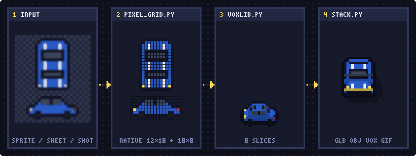

<div align="center">

# sprite-in-the-round

**Turn pixel-art sprites into 3D models with your AI agent.**

Give an agent a sprite, an object turnaround or a directional character sheet.<br />
It builds a coloured voxel volume and delivers a **GLB**, an **OBJ**, a slice sheet, a PNG preview and an HTML viewer.


[](LICENSE)

[Quick Start](#quick-start) · [What's Inside](#whats-inside) · [Examples](#usage-examples) · [Compatibility](#compatibility) · [Contributing](#contributing)

</div>

---

## Introduction

`sprite-in-the-round` is an [Agent Skill](SKILL.md): a folder of instructions, reference guides and Python helpers that teaches an AI agent how to turn 2D pixel art into a static 3D model.

The agent builds the shape as **horizontal pixel layers**. The same layers work two ways:

- as a **solid mesh** you can open in Blender or import into a game engine, and
- as a **sprite stack** for fake-3D turning in a 2D game.

<p align="center">
  
  <br />
  <sub>The car from <code>evals/files</code>, run through each step. <code>stack.py</code> writes GLB + OBJ, a PNG preview and an HTML viewer, plus optional direction sheets, a GIF and <code>.vox</code> for sprite stacking.</sub>
</p>

**What works best as input**

| Input | How the agent uses it |
|---|---|
| **Object model sheet** | Top, side, front and back at the same scale give the most information. Two or three views can be enough. |
| **Character sheet** | Matching poses from several directions, sculpted part by part. |
| **A single sprite** | Works too. Depth, top and back details are inferred. |
| **Only a description** | The agent draws the views itself or builds from primitives. |

## Quick Start

**1. Install the skill.**

```bash
npx skills add SoAp9035/sprite-in-the-round
```

Add `-g` to install it for your user instead of the current project. Requires Node.js 22.20+.

Or clone it into your project manually:

```bash
git clone https://github.com/SoAp9035/sprite-in-the-round.git .agents/skills/sprite-in-the-round
```

Use `~/.agents/skills/` for all projects, or `.claude/skills/` for Claude Code. Keep the folder name `sprite-in-the-round`.

| Agent | Location |
|---|---|
| Claude Code | `~/.claude/skills/sprite-in-the-round` or `<project>/.claude/skills/` |
| Clients following the cross-client convention | `~/.agents/skills/sprite-in-the-round` or `<project>/.agents/skills/` |
| Other agents | Check where they load skills from, or point them at `SKILL.md`. |

**2. Have the dependencies available.** The helper scripts need Python 3.9+ with NumPy and Pillow. Grid recovery also uses SciPy and headless OpenCV. With [uv](https://docs.astral.sh/uv/) installed, `uv run scripts/<name>.py` installs them automatically from the script headers.

**3. Ask your agent.** Attach your art and describe what you need. The skill triggers on requests like *"make this pixel art 3D"*, pixel art to GLB/OBJ, voxel props, sprite stacking, or rotatable pixel art.

> [!TIP]
> The skill works best with an agent that can look at images: it reads views, faces and poses from the art itself.

## What's Inside

### The skill

| | Skill | Description |
|---|---|---|
| 🧊 | [**sprite-in-the-round**](SKILL.md) | Build a static, rotatable 3D pixel-art model from a sprite, a 4-view model sheet, a turnaround, a directional character sheet, or just a description. Export it as GLB and OBJ for any 3D tool or engine, or as sprite-stack slices and direction sheets for a 2D game. |

### Reference guides

The agent loads these on demand while it works.

| Stage | Guide | Covers |
|---|---|---|
| Input | [clean-input.md](references/clean-input.md) | Getting clean, native-resolution pixel art from screenshots, upscales and JPEGs |
| Input | [making-views.md](references/making-views.md) | Designing views you don't have, as character grids |
| Build | [build-volume.md](references/build-volume.md) | Volume coordinates, painting, primitives and worked examples |
| Build | [sculpt-a-character.md](references/sculpt-a-character.md) | Sculpting characters part by part with clean, flat paint |
| Build | [sheets-and-animation.md](references/sheets-and-animation.md) | Reading character sheets and animating slice sheets |
| Ship | [render-and-ship.md](references/render-and-ship.md) | `stack.py` outputs, exact render math and voxel import/export |
| Ship | [sprite-stacking-guide.md](references/sprite-stacking-guide.md) | Sprite stacking, game-engine integration and pixel-perfect rendering (adapted from SpriteCook) |

### Tools

| Path | Purpose |
|---|---|
| [`scripts/pixel_grid.py`](scripts/pixel_grid.py) | Screenshot / upscale / JPEG → native pixel art; splits model sheets into views |
| [`scripts/voxlib.py`](scripts/voxlib.py) | Building blocks the agent imports: `stack_views`, `carve`, `sculpt`, `decal`, `lathe`, `inflate`, `paint`, … |
| [`scripts/stack.py`](scripts/stack.py) | Static GLB + OBJ and preview from a slice sheet, plus optional 2D exports |
| [`scripts/glb.py`](scripts/glb.py) | GLB and OBJ mesh writers used by `stack.py` |
| [`assets/viewer.html`](assets/viewer.html) | Standalone viewer: 3D normal/AO lighting, slice scan, exploded view, 16-direction export |

<details>
<summary><b>Repository layout</b></summary>

```
SKILL.md                technique, workflow, gotchas (loaded when the skill triggers)
references/             guides loaded on demand
scripts/                pixel_grid.py, voxlib.py, stack.py, glb.py, vendored pixelfixer/
assets/viewer.html      standalone slice-sheet viewer
evals/evals.json        test prompts (agentskills.io eval format)
evals/files/            sample input art for the evals
evals/test_*.py         regression tests
```

</details>

## Usage Examples

### Prompts

Adapted from the skill's [evals](evals/evals.json):

| You say | You get |
|---|---|
| *"I took a screenshot of my potion sprite in my pixel editor. It's 64x64. Can you turn it into a 3D thing I can spin around?"* | Grid recovered from the screenshot, then a GLB, OBJ, slice sheet, preview and viewer |
| *"Here are the top and side views of my little car. I need 16 direction sprites for my top-down racer in Godot."* | Art brought to native size, a carved volume, the slice sheet and a 16-direction sheet |
| *"Make this mushroom guy 3D."* | A model with inferred depth and back, plus GLB, OBJ, slice sheet, preview and viewer |
| *"Can you make me a sprite-stacked wooden treasure chest, about 24 px wide, for my top-down game? I don't have any art."* | A slice sheet designed from scratch |
| *"I need a street lamp for my top-down sprite-stacking game, about 40 px tall, and the same lamp as an .obj for Blender."* | A slice sheet for the game plus GLB and OBJ |

### Under the hood

The agent runs commands like these from the skill directory.

**Recover native pixels** from an enlarged, blurry or screenshotted image:

```bash
uv run scripts/pixel_grid.py sheet.png -o art.png --split
uv run scripts/pixel_grid.py screenshot.png -o art.png --size 64x64
```

**Build the volume** with a small script that imports `voxlib`:

```python
# /// script
# dependencies = ["numpy", "pillow"]
# ///
import sys
sys.path.insert(0, "scripts")  # use the skill's absolute scripts path when building elsewhere
from voxlib import load, save_sheet, stack_views, trim

volume, outline = stack_views(top=load("top.png"), side=load("side.png"),
                              front=load("front.png"), back=load("back.png"))
save_sheet(trim(volume), "car_slices.png", outline=outline)
```

**Export and inspect:**

```bash
uv run build.py
uv run scripts/stack.py car_slices.png          # car.glb, car.obj (+ .mtl, palette), car_preview.png, car_viewer.html
uv run scripts/stack.py car_slices.png --all    # + 16-direction sheet, turntable GIF, .vox
```

<details>
<summary><b>Output files</b></summary>

| File | Contents |
|---|---|
| `NAME.glb` | Solid, flat-coloured mesh with an embedded palette texture. Y up, front +Z, 16 art pixels per metre (`--height M` or `--ppm N` to rescale). |
| `NAME.obj` | The same mesh as OBJ, with `NAME.mtl` and `NAME_palette.png` (keep the three together). |
| `NAME_preview.png` | Eight turns of the stack, then flat front, side, back and top views. |
| `NAME_dirsN.png` | `--dirs N`: N facings for a 2D game. |
| `NAME_turntable.gif` | `--gif`: a turning (and animating) preview. |
| `NAME_viewer.html` | Self-contained, drag-to-turn viewer (`--no-viewer` skips it). |
| `NAME.vox` | `--vox`: MagicaVoxel model. |

See [render-and-ship.md](references/render-and-ship.md) for every option.

</details>

## Compatibility

| | |
|---|---|
| **Agents** | Claude Code, clients that load skills from `.agents/skills/`, or any agent you can point at `SKILL.md`. Best with an agent that can look at images. |
| **Runtime** | Python 3.9+ with NumPy and Pillow; SciPy and headless OpenCV for grid recovery. [uv](https://docs.astral.sh/uv/) recommended. |
| **3D tools** | GLB for Blender, Godot, Unity (via glTFast), three.js and web viewers; OBJ for everything else; `.vox` for MagicaVoxel. |
| **2D games** | Slice sheets for live sprite stacking, or pre-rendered direction sheets. See the [integration guide](references/sprite-stacking-guide.md). |

## Contributing

Contributions are welcome. Before opening a pull request:

1. Run the regression tests:

   ```bash
   uv run --with numpy --with pillow --with scipy --with opencv-python-headless python -m unittest discover -s evals
   ```

2. If you change the agent's behaviour, update or add a case in [`evals/evals.json`](evals/evals.json) (agentskills.io eval format).
3. Keep `SKILL.md` focused on the core workflow and move detail into `references/`.

## License

Released under the [MIT License](LICENSE) © 2026 Ahmet Burhan Kayalı.

The damaged-grid detector in [`scripts/pixelfixer/`](scripts/pixelfixer/) is vendored from [Pixel Art Fixer](https://github.com/Retro-Diffusion/pixel-art-fixer/tree/ef376e57e1c272633ca2dbf5f29ec3fcf6596465/python/pixelfixer) under the [MIT License](scripts/pixelfixer/LICENSE).
